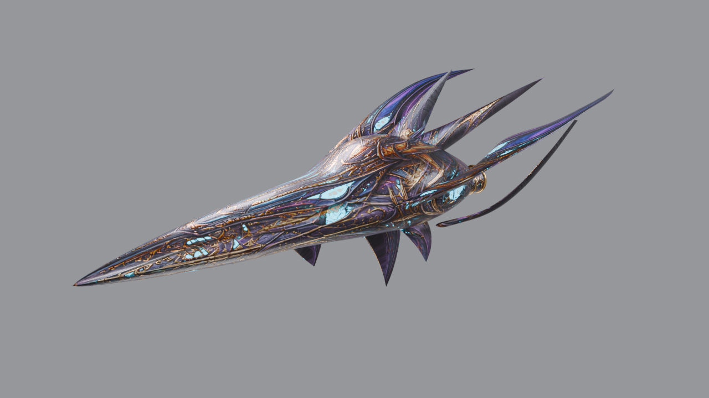
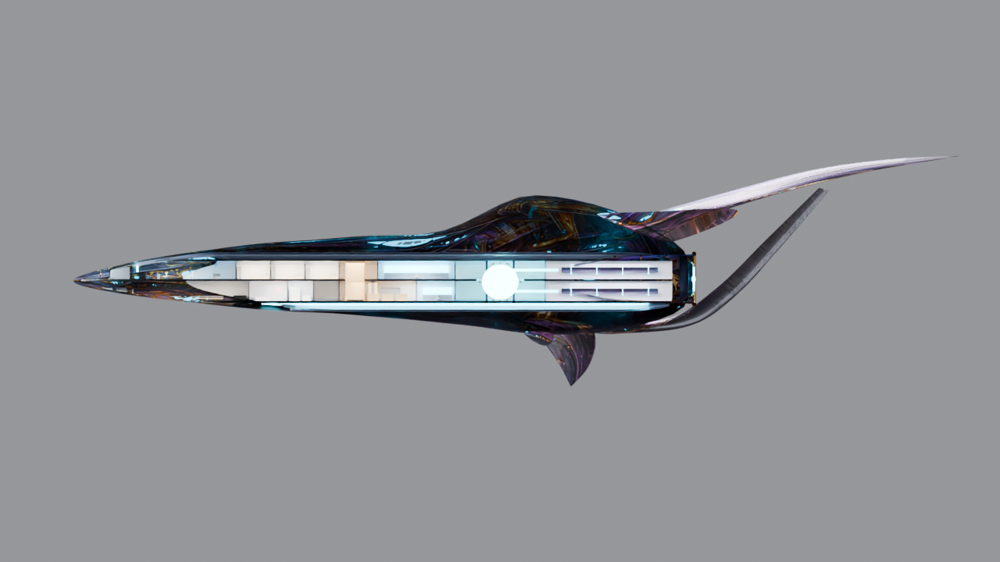
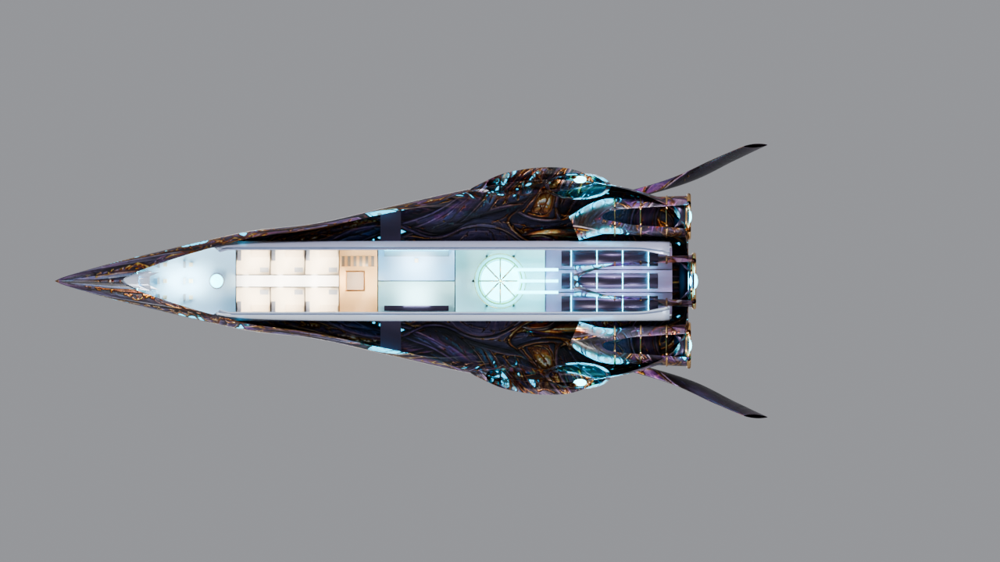

# Starship V1 — 96m Sci-Fi Starship 3D Model & Interactive Web Preview

**Online Interactive 3D Preview (GitHub Pages):**
https://xuzhiming.github.io/antShip/

## Overview
- **Dimensions**: Length `96 m` (hull `85.6 m` + swept rear spines), Span `48 m`, Total Height `44 m`, Crew `12`
- **Dual-Deck Pressure Hull**:
  - **Upper Deck (`Z +3.6 m`)**: Sensors, Bridge, 6 Crew Cabins + Central Corridor, Logistics Lift/Stairs, Engine Control / ISO, Upper Energy Core, Upper Engine Bays
  - **Lower Deck (`Z 0 m`)**: Avionics, Mess / Galley, Medical / T/S / Store, Life Support, Cargo + Port/Starboard Airlocks, Lower Energy Core, Lower Engine Bays
- **4K 6-View PBR Exterior**: `4096×4096` albedo, emissive, metallic, roughness, and tangent-space normal maps baked from 6 orthographic HD concept views (`M_Exterior_HD`), with sculpted bronze-gold filigree, indigo-purple armor, cyan portholes, open rear wing arches, and triple rear thrusters.

## Cycles Renders
| Hero Exterior | Rear Triple Engines |
| :---: | :---: |
|  |  |
| **Side Cutaway** | **Top Cutaway** |
|  |  |

## Repository Structure
- `starship_v1.blend` — Master Blender 5.2 scene with full exterior, dual-deck interior, lighting, cameras, and `toggle_cutaway.py`
- `rebuild_sleek_hull.py` — Parametric sleek hull, fins, wing-loop arches, engines, and interior refit/clipping script
- `textures/` — `prep_hd_views.py`, `bake_hd_textures.py`, and 4K `hd_exterior_*.png` PBR maps
- `renders/` — Cycles 1280×720 renders (`hero_exterior.png`, `rear_engines.png`, `side_cutaway.png`, `top_cutaway.png`)
- `web/` — Self-contained Three.js WebGL interactive viewer (`index.html`, `starship_v1.glb`, `export_glb.py`, vendored `vendor/three/`)
